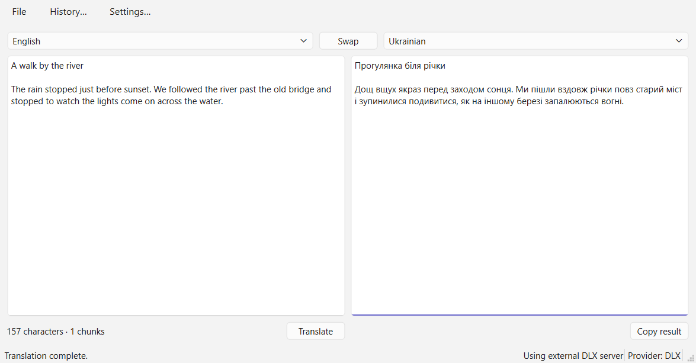
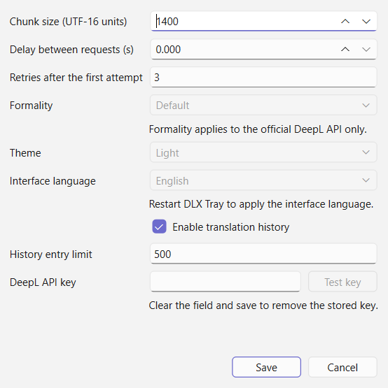

# DLX Tray

A desktop translator for Windows built with Python 3.12 and PySide6. **DLX Tray v2.0** translates
long texts and documents in chunks using a bundled [DLX](https://github.com/OwO-Network/DLX)
(formerly DeepLX) server with optional official DeepL API fallback. On the **v3.0** track, DLX Tray
is evolving into a **hybrid philological translator** combining local DLX, Official DeepL, and a
lightweight multi-user **Google Cloud Run + Firestore + Gemini API** backend tailored for philology
students and translators.

> **Windows installer (v2.0.0 stable):** Download the latest published `DLX-Tray-Setup-X.Y.Z.exe`
> from the [Releases](https://github.com/zrumyk/DLX-Tray/releases) page.



The screenshot uses an example translation from a local test server.

---

## Release Status: v2.0 Stable vs. v3.0 Next-Generation

| Track | Status | Summary |
|---|---|---|
| **v2.0.0** | **Available now** ([Releases](https://github.com/zrumyk/DLX-Tray/releases)) | Local bundled DLX + Official DeepL API fallback, TXT/DOCX/PDF file translation, local SQLite segment cache & history, system tray, `Ctrl+C,C` selection popup, Windows autostart, English/Ukrainian UI. |
| **v3.0.0** | **In development** | Hybrid 3-provider routing (`DLX` + `Cloud AI Proxy` + `Official DeepL`), adaptive LLM context blocks & parallelism, philological registers (incl. *підрядник*), two-pass document glossaries, philological notes Inspector & DOCX comments, and a shared Cloud Run + Firestore + Gemini 4 backend. |

---

## Current Features (v2.0.0 Stable Release)

### Desktop integration and workflow
- Keep translations running in the Windows notification area when you minimize or close the window.
- Translate selected text from any Windows application in a popup using a configurable global
  shortcut (`Ctrl+C` twice by default, or `Ctrl+Shift+<letter>`).
- Optionally start DLX Tray in the notification area when you sign in to Windows.
- Install for the current Windows user without administrator rights, with a Start menu shortcut
  and an optional desktop shortcut.
- Choose **Light**, **Dark**, or **Follow Windows** (theme changes apply immediately), and restore
  window size, position, maximized state, and last selected languages on startup.
- Choose **English** or **Ukrainian** for the interface in Settings (applies on restart), with
  localized language pickers and detected-language labels.

### Translation engine, caching, and providers
- Translate in side-by-side editors using **Translate** or **Ctrl+Enter**, stream chunks in order as
  they complete, swap languages/texts (including after **Auto-detect**), and cancel at any point
  while keeping completed work.
- Start and stop the bundled DLX server automatically on a free localhost port, with live startup
  and active-provider status in the status bar.
- Choose **Automatic** mode (local DLX with per-chunk fallback to your **Official DeepL API** Free
  or Pro key on rate limits/outages) or **Official DeepL API only** mode.
- Split long input cleanly at paragraph, line, sentence, and word boundaries into chunks of up to
  `1,500` UTF-16 code units, preserving exact whitespace and line-ending separators on reassembly.
- Reuse completed paragraph and file-segment translations from a local 30-day SQLite cache, share
  overlapping in-flight chunk requests, pair small neighbouring DLX chunks (`<= 750` units), and
  dispatch up to **2 concurrent DLX requests** while keeping preview output in strict input order.
- See a live countdown before scheduled retries, and **Continue**, **Skip**, or **Cancel** when a
  chunk exhausts automatic retries.
- Configure chunk size, inter-request delay, retry count, DLX concurrency, and official DeepL
  formality in Settings; store your DeepL API key in **Windows Credential Manager**.

### Documents, history, and diagnostics
- Open or drag-and-drop `.txt` (encoding auto-detected, saved as UTF-8), `.docx` (preserving
  headings, lists, tables, headers, and footers), and text-layer `.pdf` files (reconstructing
  paragraphs and exporting to `.docx` or `.txt`).
- Search saved text and file translations case-insensitively in SQLite history, reopen entries in
  the editors, delete individual items, clear history, or configure retention limits.
- Open **Help → About DLX Tray** for version and license notices, or copy a privacy-filtered
  Markdown diagnostics report (timings, worker limit, local cache hits/misses, retry waits, and
  redacted log tail—never user text or credentials).

---

## Install (v2.0.0)

1. On Windows 10 version 1809 or later or Windows 11 x64, download the latest
   `DLX-Tray-Setup-X.Y.Z.exe` from [Releases](https://github.com/zrumyk/DLX-Tray/releases).
2. Run Setup for your Windows account. Select the desktop shortcut during setup if you want one.
3. Open **DLX Tray** from Start. Enter text, select a target language, and choose **Translate**
   or press **Ctrl+Enter**. In automatic mode, wait for **DLX ready** before translating.

To upgrade, close DLX Tray and run the newer installer over your existing installation. Setup
preserves your settings, credentials, and translation history.

## Notification Area and Selection Shortcut

Minimize or close the window to keep DLX Tray running in the Windows notification area. Click the
icon or launch the app again to reopen the window. The icon's tooltip shows provider status and any
known DLX cooldown. Choose **Exit** from the icon's menu or **File → Exit** to quit.

Select text in another Windows app and press **Ctrl+C** twice quickly to translate it in a popup.
The shortcut copies the selection to the clipboard, uses the languages and provider selected in
DLX Tray, and lets you copy the result. In **Settings → Selection hotkey**, choose `Ctrl+Shift`
plus a Latin letter (for example, `Ctrl+Shift+Y`) or clear the field to disable it.

In the installed app, turn on **Start DLX Tray when I sign in to Windows** in Settings and save.
Clear the checkbox and save to remove the startup entry. Windows can also disable the entry under
**Settings → Apps → Startup**.

---

## Next-Generation Architecture (v3.0 — In Development)

> [!NOTE]
> The capabilities in this section represent the **approved v3.0 architecture currently in active
> development** and are not yet included in the published `v2.0.0` installer.

DLX Tray v3.0 expands the Python 3.12 desktop client with a lightweight, self-hosted team proxy on
**Google Cloud Run + Cloud Firestore + Google Gemini API**, turning the app into a hybrid
translation environment for **philology students, literary/academic translators, and small teams**:

1. **Hybrid Three-Provider Pipeline (`DLX` + `Cloud AI` + `Official DeepL`):**
   - Keeps local bundled **DLX** as the zero-cost, low-latency engine for everyday snippets and
     `Ctrl+C,C` selection popups, with smart automatic fallback (`DLX → Cloud AI → Official DeepL`)
     when DLX hits HTTP 429 rate limits.
   - Routes whole documents (`.txt`, `.docx`, `.pdf`), long texts, and philological workflows
     directly to the **Cloud AI** provider, while retaining explicit manual modes (`Automatic`,
     `Cloud AI only`, `Local DLX only`, `Official DeepL API only`).
2. **Adaptive Chunking and Provider-Specific Parallelism:**
   - Replaces fixed chunking with per-provider execution profiles: compact `<= 1,500` UTF-16 chunks
     (`1–2` workers) for local DLX versus large multi-paragraph context blocks (`8,000–12,000`
     UTF-16 units, `2–4` parallel workers, plus read-only preceding paragraph context for pronoun,
     gender, and narrative continuity) for the Cloud LLM backend—while keeping exact 1:1 paragraph
     mapping for `.docx` and `.pdf` exports.
3. **Philological Workbench Features:**
   - **Stylistic registers:** Switch between *Neutral*, *Literary (Художній)*, *Academic
     (Академічний)*, *Journalistic (Публіцистичний)*, *Official (Офіційно-діловий)*, and
     *Philological crib / Interlinear literal (Підрядник)*, plus an optional era/domain context hint.
   - **Document terminology consistency:** Manage local SQLite glossaries with UTF-8 CSV/TSV
     import/export, and run an optional **Pass-1 AI term extraction** before parallel file
     translation to review and lock recurring terms and proper names across the whole document.
   - **Philological notes:** Inspect alternative phrasings, idiom/realia explanations, and
     grammatical/syntactic commentary in a collapsible **MainWindow Inspector**, on demand inside
     the **`Ctrl+C,C` Selection Popup**, or optionally exported as native **Word comments** in
     `.docx` files (keeping standard document exports clean).
4. **Cloud Run Proxy Backend, Security, and Shared Budget Caching:**
   - Isolates Gemini API credentials on a stateless **Google Cloud Run** microservice (`cloud/`,
     built with `FastAPI` and `google-genai` with zero-retention `store=False`), routing between a
     fast default model (**Gemini 4 Hydrogen**) and an opt-in deep-analysis model (**Gemini 4 Neon**)
     configured via Cloud Run environment variables.
   - Authenticates desktop clients with individual team bearer tokens stored locally in **Windows
     Credential Manager** and verified server-side as HMAC-SHA256 hashes in **Cloud Firestore** with
     atomic per-user character quotas.
   - Caches completed segment translations and philological notes in **Cloud Firestore** under
     anonymous SHA-256 digests with native TTL expiration—saving Gemini budget across classmates and
     teammates without storing raw source texts.
   - Server dependencies remain strictly isolated from the PyInstaller desktop build so the Windows
     installer stays compact and MIT-compliant.

---

## FAQ

### What should I do if DLX returns HTTP 429?

HTTP 429 means DLX is rate-limited. Tray waits before retrying and shows the retry delay in the
status bar. You can cancel and keep any translation that already finished. If you save a DeepL API
key in v2.0 (or configure the Cloud AI / DeepL fallback chain in v3.0), Tray continues the job
automatically. Check the status bar for the active provider.

### Why is Windows warning me about the installer?

Microsoft Defender SmartScreen may warn about a downloaded installer with an unfamiliar reputation.
Verify that the download came from the official DLX Tray Releases page before opening it.

### Where do I enter my DeepL API key?

A DeepL API Free or Pro key is optional. Open **Settings…**, enter it in **DeepL API key**, choose
**Test key**, then **Save**. The test checks the key without sending translation text. Tray saves
the key in Windows Credential Manager. To remove it, clear the field and save again.

Choose **Official DeepL API only** under **Translation provider** to use the key for all text and
file translations. Automatic mode is the default and uses DLX with official API fallback.



---

## Build from Source

Requirements: Windows 10 version 1809 or later or Windows 11 x64, Python 3.12,
[uv](https://docs.astral.sh/uv/).

```powershell
git clone https://github.com/zrumyk/DLX-Tray.git
cd DLX-Tray
uv sync --all-groups
uv run python scripts/fetch_deeplx.py   # builds the pinned DLX binary into vendor/ on first run
uv run dlx-tray
```

To package the desktop app from source, run `.\scripts\build.ps1` in PowerShell. Open
`dist/DLX Tray/DLX Tray.exe` and keep the entire `dist/DLX Tray` folder together when moving it.

The bundled server is built from the [DLX fork at `177f235`](https://github.com/zrumyk/DLX/commit/177f2355274295a6bee35feaccc27fe06fbd1fa1).
On 27 November 2026, a locally built installer translated **Hello** to **Привіт** in a clean
Windows Sandbox. Tray showed **Provider: DLX** and completed the translation in one request with no
API key or external server configured. Long-file translation and export were tested separately with
a local test server.

Quality gates and development commands (enforced across all desktop and upcoming v3.0 cloud modules):

```powershell
uv run pytest            # unit & Qt tests (network tests skipped; run with -m live)
uv run pytest --cov      # >= 85% branch coverage gate for Qt-free desktop and cloud layers
uv run pytest -k performance
uv run --isolated --no-dev --with pip-licenses python scripts/check_licenses.py
uv run ruff check --fix  # lint
uv run ruff format       # format
uv run pyright           # strict/standard static type check
uv run pre-commit install
```

### Configuration

Copy `.env.example` to `.env` for local development. The app loads preferences from
`%APPDATA%\DLX Tray\settings.json` and applies `DLX_*` development overrides. Set `DLX_DEEPLX_URL`
and, if required, `DLX_DEEPLX_TOKEN` to use an external DLX server.

For official DeepL API fallback, save a key in Settings (stored in Windows Credential Manager) or
set `DLX_DEEPL_API_KEY` in the process environment or local `.env` during development. Non-empty
process environment variables take precedence over `.env`; when unset or blank, Tray uses the
credential stored in Windows Credential Manager.

---

## Roadmap

| Version | Status | Scope |
|---|---|---|
| `0.1.0` | Completed | Project skeleton, tooling, CI |
| `0.2.0` | Completed | UTF-16 chunker, DLX client & process manager, pipeline, local settings & logs |
| `0.3.0` | Completed | Main window: languages, streaming progress, cancel, automatic DLX startup |
| `0.4.0` | Completed | Official DeepL API fallback, error recovery dialog, Credential Manager storage |
| `0.5.0` | Completed | Settings dialog, themes, saved window geometry and language selections |
| `0.6.0` | Completed | `.txt`, `.docx`, and `.pdf` document translation and export |
| `0.7.0` | Completed | Local SQLite translation history and search |
| `0.8.0` | Completed | Ukrainian and English UI localization |
| `0.9.0` | Completed | PyInstaller packaging, Inno Setup installer, and GitHub Releases |
| `1.0.0` | Completed | First stable release with audited bundled DLX, About dialog, and diagnostics |
| `2.0.0` | **Released** | Segment cache, 2-worker DLX concurrency, provider selection, visible retry waits, system tray, `Ctrl+C,C` global hotkey, and optional Windows autostart |
| `3.0.0` | **In development** | Hybrid pipeline (`DLX` + `Cloud AI` + `DeepL`), adaptive LLM context blocks, philological registers & *підрядник*, two-pass glossaries, philological notes Inspector & DOCX comments, Cloud Run + Firestore + Gemini 4 proxy |

See [CHANGELOG.md](CHANGELOG.md) for what changed in each published version.

## Disclaimer

This is a personal, non-commercial project. It is **not** affiliated with, endorsed by or sponsored
by DeepL SE. "DeepL" is a trademark of DeepL SE. DLX talks to DeepL's free web service in a way
DeepL does not officially support. It may stop working at any time, it is rate limited, and using it
may conflict with DeepL's terms of service. Use at your own risk.

## License

[MIT](LICENSE). DLX is distributed under its own MIT license.
